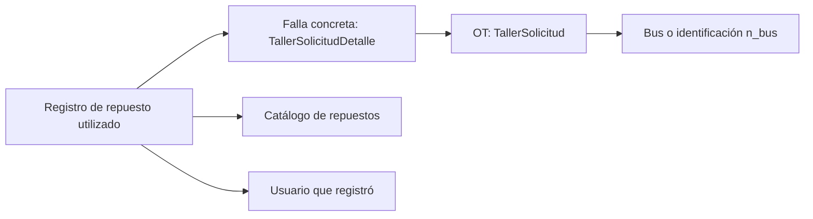

# Plan de implementación: repuestos utilizados por falla

Fecha: 2026-11-04. Estado: implementación local desarrollada; ver guía de integración y resultados de pruebas.

## 1. Resultado esperado y alcance

El mecánico o supervisor abre una OT, selecciona una de sus fallas concretas, busca un repuesto del catálogo y registra que se utilizó. El backend conserva el artículo, la falla, el usuario que lo registró y la fecha del registro. La OT y el bus se obtienen a través de las relaciones existentes.

El alcance incluye catálogo consultable y administrable, registro de uso con cantidad informativa, consulta del historial y anulación por error. El catálogo incluye precio e IVA informativos. No incluye existencias, bodegas, ubicaciones, compras ni proveedores. El catálogo puede contener repuestos y otros artículos técnicos que se decida conservar del maestro.

Cada asociación indica **qué artículo y qué cantidad se declararon como utilizados en esta falla**. La cantidad es informativa y no descuenta existencias. Se podrán sumar cantidades por artículo y unidad, y contar fallas por separado; no se deben sumar unidades diferentes ni interpretar las cifras como stock.

El desarrollo de este repositorio cubre exclusivamente backend y contratos API. Las pantallas corresponden al repositorio de frontend.

## 2. Base existente y puntos de integración

| Componente actual | Uso en la implementación |
| --- | --- |
| `TallerSolicitud` (`app/modules/taller/models/taller_solicitud.py`) | OT con `es_ot`, `estado`, `bus_id` opcional y `n_bus` obligatorio. |
| `TallerSolicitudDetalle` (`app/modules/taller/models/taller_solicitud_detalle.py`) | Falla concreta seleccionada dentro de la OT; será el destino de la asociación. |
| `FallaTaller` | Catálogo general de fallas; no será el destino del registro de uso. Se admitirán también detalles de falla personalizados. |
| `require_mecanico_or_supervisor_or_admin` (`app/api/deps.py`) | Autorización de consulta y registro. |
| `require_supervisor_or_admin` (`app/api/deps.py`) | Administración del catálogo. |
| `TallerRepository.get_detalle_operacional` | Verificar que el detalle pertenece a la OT indicada. |
| `TallerRepository.lock_solicitud_estado` | Coordinar registro/anulación con cierre y eliminación de fallas. |
| `OperacionResultado` (`taller_resultado_operaciones`) | Conservar recibos de operaciones para reintentos seguros, como ya hace el registro de resultados de falla. |
| `ResultadoFallaService.registrar` | Referencia para validación de usuario activo, OT aprobada y asignación activa del mecánico. |
| Bitácora de OT y `touch_fecha_actualizacion` | Evidencia legible y actualización de la versión de la OT. |

El endpoint actual `PATCH /api/v1/taller/{id}/detalles/{detalle_id}/repuesto` administra el indicador `falta_repuesto`. Se conserva su contrato. Registrar un artículo utilizado no resuelve la falla ni cambia automáticamente ese indicador.

## 3. Modelo de datos propuesto

Se agregarán dos tablas dentro del módulo `taller`, con SQLAlchemy 2.0, `TimestampMixin`, claves foráneas restrictivas y DTOs propios.

### 3.1. Catálogo: `repuestos`

| Campo | Regla |
| --- | --- |
| `id` | Identificador interno. |
| `codigo` | Texto obligatorio y único; el supervisor puede modificarlo sin cambiar el ID. Conservar ceros iniciales y códigos alfanuméricos. Los espacios exteriores se eliminan en la API. |
| `nombre` | Obligatorio y no vacío. |
| `parte` | Opcional; no es clave única. |
| `unidad` | Opcional; presentación según Excel, por ejemplo `UN` o `KIT`, sin inferir equivalencias entre presentaciones. |
| `precio` | Precio unitario neto informativo, procedente de `$ Unit`; número decimal exacto, no negativo. Cero se conserva como valor registrado y no acredita precio conocido. |
| `iva` | Monto de IVA unitario informativo, procedente de `Iva`; decimal exacto, no negativo. Es un monto, no una tasa. |
| `clasificacion`, `clasificacion_1` | Opcionales; corresponden respectivamente a `Clasificacion General` y `Clasificacion 1` del Excel. |
| `modelo` | Opcional; atributo descriptivo del artículo. |
| `is_active` | Define si puede seleccionarse para nuevos registros. Baja lógica. |
| `created_at`, `updated_at` | Auditoría temporal del catálogo. |

El supervisor o administrador puede modificar código y demás atributos, y activar o desactivar el artículo. El ID es inmutable. El nuevo código debe ser único; los usos anteriores conservan el código registrado originalmente mediante una copia histórica. No se deduplicará solo por nombre o número de parte, porque artículos diferentes pueden compartirlos.

### 3.2. Asociación: `taller_repuestos_utilizados`

| Campo | Regla |
| --- | --- |
| `id` | Identificador del registro. |
| `falla_detalle_id` | Identifica la falla concreta; FK obligatoria a `taller_solicitud_detalles.id`. |
| `repuesto_id` | FK obligatoria a `repuestos.id`. |
| `cantidad_utilizada` | Obligatoria, numérica exacta (`Numeric`), mayor que cero; admite fracciones para artículos como lubricantes. La cantidad es declarada, sin efecto sobre existencias. |
| `unidad_al_registrar` | Unidad del catálogo al registrar, opcional si no está disponible; no asumir que un valor vacío significa unidades. |
| `usuario_registro_id` | FK obligatoria a usuario; se obtiene de la sesión. |
| `codigo_repuesto_al_registrar`, `nombre_repuesto_al_registrar`, `parte_repuesto_al_registrar` | Identidad descriptiva del artículo al registrarlo, para conservar su significado si luego se edita el catálogo. |
| `nombre_usuario_al_registrar` | Nombre del autor al registrar. |
| `created_at`, `updated_at` | La fecha de alta es la fecha de registro del servidor; no se presentará como fecha exacta del uso físico. |
| `fecha_anulacion`, `usuario_anulacion_id`, `nombre_usuario_al_anular`, `motivo_anulacion` | Vacíos en registros vigentes; completos al anular. |

No duplicar `bus_id` ni `solicitud_id`: se derivan del detalle. En consultas se devolverán como contexto. Si la OT aún no tiene `bus_id`, conservar la identificación mediante `n_bus`.

Restricciones e índices:

- FK `RESTRICT` a detalle, repuesto y usuarios, sin borrado en cascada del historial.
- Una asociación vigente por `(falla_detalle_id, repuesto_id)`, con índice único parcial donde `fecha_anulacion IS NULL`.
- Índices para consultar por detalle, repuesto y fecha; revisar el plan de consulta antes de agregar índices redundantes.
- CHECK para exigir que los datos de anulación estén todos vacíos o todos informados, con motivo no vacío y fecha no anterior al alta.
- No editar `falla_detalle_id`, `repuesto_id`, autor, fecha original ni copias históricas de un registro existente. Una corrección se hace anulando y registrando la asociación correcta.

## 4. Reglas de negocio y permisos propuestos

Estas reglas completan el alcance acordado usando los permisos actuales como referencia:

| Acción | Mecánico | Supervisor / administrador |
| --- | --- | --- |
| Consultar catálogo e historial de OT | Sí, conforme al acceso actual a la OT. | Sí. |
| Registrar artículo utilizado | Con asignación activa en esa falla. | Sí, sin exigir asignación. |
| Anular un registro | Propio, con acceso vigente a la falla. | Cualquier registro autorizado. |
| Crear, editar código y otros campos, activar o desactivar catálogo | No. | Sí. |

Condiciones comunes:

1. Usuario autenticado y activo. Conductor sin acceso a las nuevas operaciones.
2. OT existente con `es_ot=true`; una solicitud no aprobada no admite usos.
3. El detalle debe pertenecer a esa OT y el artículo debe existir y estar activo al darlo de alta.
4. La OT `FINALIZADO` admite lectura; para nuevas altas o anulaciones se utiliza el mecanismo existente de reapertura.
5. No se exige que la falla esté pendiente. Se permite completar su trazabilidad después de resolverla mientras la OT siga abierta y el actor tenga permiso. Si la asignación del mecánico terminó, podrá hacerlo supervisión.
6. Registrar uso no cambia el estado de la OT/falla, asignaciones, estadías ni ubicación del taller. Tampoco exige registrar un repuesto para cerrar una falla: hay reparaciones sin repuestos.
7. Una misma falla puede tener cero, uno o varios tipos de repuesto diferentes. Cada tipo y su cantidad se registran de forma individual y quedan reflejados en el texto de la bitácora con falla, código, nombre y cantidad. Se mantiene una asociación vigente por artículo y falla: su cantidad representa el total declarado para esa falla. Para corregirla se anula el registro con motivo y se crea uno nuevo con la cantidad correcta; se conserva el historial.
8. Un doble envío del mismo artículo y cantidad devuelve la asociación vigente sin duplicar fila, bitácora o notificación. Si ya hay una asociación vigente con cantidad diferente, se responde `409` y se indica que debe corregirse mediante anulación y nuevo registro. La validación también debe funcionar con peticiones concurrentes. Cada intención de alta/anulación llevará un `operacion_id` UUID generado por el cliente y conservado entre reintentos; no es un campo que complete el usuario.
9. La anulación requiere motivo y conserva el original. Repetirla no reemplaza autor, fecha ni motivo de la primera anulación. Para registrar nuevamente el artículo se crea una asociación nueva con otro UUID. Reintentar un alta original después de anularla nunca reactiva el registro.
10. La desactivación o edición del catálogo no altera registros históricos ni sus snapshots.

### Protección frente a eliminación de fallas

`AveriasService.eliminar_falla` y `TallerRepository.delete_detalle_con_dependencias` eliminan físicamente el detalle y sus dependencias. Se agregará una comprobación de negocio previa: **una falla con registros de repuestos, vigentes o anulados, no podrá borrarse físicamente**. La FK `RESTRICT` será la protección final.

El bloqueo se coordina con el mismo lock de OT para impedir carreras entre registrar, cerrar y borrar. La edición justificada del texto de la falla puede mantenerse: el `detalle_id` sigue siendo el mismo y la bitácora existente conserva la corrección.

## 5. Contratos API propuestos

Prefijo común: `/api/v1`. Todos los endpoints tendrán DTO de respuesta y errores de dominio. Todas las colecciones tendrán `skip`, `limit` y total, con límite máximo 100.

| Método y ruta | Propósito |
| --- | --- |
| `GET /taller/repuestos?q=&skip=0&limit=20` | Buscar por código, descripción o número de parte; solo activos por defecto. Consulta de inactivos para supervisión. |
| `POST /taller/repuestos` | Crear artículo por supervisor/admin. |
| `PATCH /taller/repuestos/{repuesto_id}` | Editar código y atributos o activar/desactivar mediante `is_active` por supervisor/admin; ID inmutable y código único. |
| `GET /taller/{id}/detalles/{detalle_id}/repuestos-utilizados` | Consultar artículos de la falla; parámetro explícito para incluir anulados. |
| `POST /taller/{id}/detalles/{detalle_id}/repuestos-utilizados` | Registrar uso con `repuesto_id`, `cantidad` positiva y `operacion_id` UUID técnico. |
| `PATCH /taller/{id}/detalles/{detalle_id}/repuestos-utilizados/{registro_id}/anulacion` | Anular con `motivo` y `operacion_id` UUID técnico. |
| `GET /taller/{id}/repuestos-utilizados` | Obtener el conjunto de la OT, indicando la falla de cada registro y el contexto de bus. Evita una petición por falla. |

Proponer DTOs `RepuestoCreateDTO`, `RepuestoUpdateDTO`, `RepuestoDTO`, `RegistrarRepuestoUtilizadoDTO`, `AnularRepuestoUtilizadoDTO` y `RepuestoUtilizadoDTO`, más respuestas paginadas. Las respuestas incluirán `solicitud_id`, `detalle_id`, `bus_id`/`n_bus`, snapshots del artículo y unidad, cantidad declarada, autor, fecha y datos de anulación. Los IDs de OT y bus serán contexto calculado, no campos editables del payload. La huella idempotente incluirá la cantidad; un nuevo intento con cantidad diferente no modifica silenciosamente un registro vigente.

Semántica: `201` al crear, `200` al recuperar una asociación vigente por repetición o al anular, `401` sin sesión, `403` sin permiso, `404` si un recurso no existe o no pertenece al contexto, `409` por conflicto y `422` por validación/regla de negocio. Un código de catálogo repetido se rechaza con `409`. Documentar los DTOs y ejemplos en OpenAPI.

## 6. Alta del catálogo

El catálogo se inicia vacío. Supervisión o administración crea y actualiza los repuestos mediante la API. No se implementa carga inicial ni importación de Excel.

## 7. Implementación por fases

| Fase | Trabajo | Entregable y condición de salida |
| --- | --- | --- |
| 0. Preparación | Preservar cambios locales, preparar rama `feature/*` desde la base GitFlow vigente; comprobar grafo Alembic y acordar reglas del apartado 4 como valores iniciales. | Base de trabajo aislada y estrategia de migración definida. |
| 1. Persistencia | Crear los dos ORM, relaciones, índices, restricciones y registro central de modelos; generar/revisar migración. | Esquema reversible validado en PostgreSQL local temporal. |
| 2. Catálogo | Implementar DTOs, repositorio, servicio y router de búsqueda/alta/edición/baja lógica, con permisos y paginación. | Catálogo operativo por API, con códigos únicos y búsqueda útil. |
| 3. Registro e historial | Implementar alta, lectura por falla/OT y anulación; validar acceso, estado y pertenencia; impedir duplicados; proteger depuración de fallas. | Flujo OT → falla → artículo trazable y consistente ante concurrencia. |
| 4. Datos iniciales | Iniciar el catálogo vacío; el supervisor registra los artículos mediante la API. | Alta y edición del catálogo disponibles. |
| 5. Validación y contratos | Pruebas focalizadas y regresión de taller/supervisión; OpenAPI, guía de integración y documentos de trazabilidad. | API documentada y criterios de aceptación comprobados. |

### Dependencia previa de Alembic confirmada

La revisión local del 2026-11-04 con `venv/Scripts/python.exe -m alembic heads` devuelve dos revisiones finales: `035_merge_dashboard_simulados` y `036_estado_neumaticos`.

La revisión 037 une las dos ramas y 038 crea el esquema de repuestos. Las migraciones se verificaron con PostgreSQL temporal; deben aplicarse mediante el proceso habitual al entorno correspondiente.

### Archivos previstos

- Nuevos modelos en `app/modules/taller/models/repuesto.py` y `taller_repuesto_utilizado.py`.
- Nuevos DTOs en `app/modules/taller/dtos/repuesto_dto.py`.
- Repositorios específicos en `app/modules/taller/repository/` para catálogo y usos.
- Servicios específicos en `app/modules/taller/services/` para catálogo y usos.
- Routers específicos en `app/modules/taller/api/`, registrados en su `router.py`.
- Registro de modelos en `app/models/__init__.py` y exports del módulo.
- Protección del borrado en `app/modules/taller/services/averias_service.py`, apoyada por consulta de existencia de usos en repositorio.
- Migración de esquema en `alembic/versions/`.
- Pruebas bajo `tests/unit/`, `tests/integration/` y `tests/migrations/`.

Mantener Router → Service → Repository y DTOs. Los servicios coordinan la transacción; los repositorios ejecutan consultas y `flush`. Los nombres y longitudes finales de campos se fijarán al implementar junto con los límites de los DTOs.

## 8. Transacciones, bitácora y actualización en tiempo real

El alta y la anulación guardarán en una sola transacción el registro, el recibo de operación, el comentario de bitácora y `fecha_actualizacion` de la OT. Usar `lock_solicitud_estado` y restricciones en BD; una comprobación previa en Python por sí sola no evita duplicados concurrentes.

Reutilizar la tabla existente `taller_resultado_operaciones` con acciones diferenciadas (`REPUESTO_ALTA`, `REPUESTO_ANULACION`), actor, detalle, huella del contenido y respuesta. Tras autenticar y verificar el contexto, un UUID repetido con el mismo actor, acción y contenido devuelve el recibo original; si difiere, responde `409`. Conservar recibos también cuando un UUID nuevo encuentra una asociación ya vigente. Esto evita que un reintento tardío posterior a una anulación vuelva a crearla. El recibo confirma una operación pasada; el estado vigente se consulta por GET, sin interpretar una respuesta histórica como reactivación.

Los nombres `created_at` y `updated_at` se mantienen por el `TimestampMixin` del proyecto: indican creación y última actualización. Los campos terminados en `_al_registrar` guardan una copia histórica, para que los cambios del catálogo no alteren lo que muestra la bitácora. `detalle_id` en rutas existentes identifica el mismo valor que `falla_detalle_id` en la tabla nueva.

Ejemplos de bitácora:

- `Repuesto utilizado en 'Fuga de aire': [código] Válvula de freno; cantidad: 2.`
- `Registro de repuesto anulado en 'Fuga de aire': [código] Válvula de freno; cantidad: 2.`

Usar el tipo de comentario existente `GENERAL`, con autor y fecha, sin ampliar los tipos de eventos de estado de falla. Crear un comentario por cada tipo de repuesto registrado o anulado; mostrar en el texto solo la falla, código, nombre y cantidad. El motivo de anulación permanece en el registro de anulación, sin incluirlo en el texto de bitácora. La corrección de cantidad genera comentarios de anulación y de nueva alta en sus respectivas transacciones. El comentario y los snapshots conservarán la referencia legible del momento del registro.

Después de un commit exitoso, publicar mediante el canal de eventos existente un `resource.changed` de la OT, con acción de alta/anulación de uso y `version` actualizada. No agregar estas rutas al adaptador HTTP legado ni publicar antes del commit. Una repetición que no modifica datos no genera comentario/evento nuevo. Un fallo del canal no revierte una escritura ya confirmada.

## 9. Verificación y criterios de aceptación

Pruebas unitarias AAA con repositorios simulados para reglas de negocio; pruebas HTTP para contratos y permisos; PostgreSQL local temporal para índices parciales, FK, concurrencia y migraciones. Las pruebas SQLite existentes que crean metadata no sustituyen la validación de Alembic/PostgreSQL.

- [ ] Registrar desde una OT y una falla devuelve artículo, falla, OT, bus o `n_bus`, autor y fecha correctos.
- [ ] Se admiten fallas personalizadas sin `FallaTaller` de catálogo.
- [ ] Rechazo de detalle ajeno a la OT, repuesto inexistente/inactivo, solicitud sin aprobar y OT finalizada.
- [ ] Mecánico asignado y supervisor pueden registrar; conductor y mecánico sin asignación reciben rechazo.
- [ ] El autor procede de sesión y no puede suplantarse desde el payload.
- [ ] Una falla admite cero, uno o varios tipos de repuestos; cada tipo aparece en el texto de bitácora con falla, código, nombre y cantidad, sin añadir otros datos al mensaje. Varias fallas pueden usar el mismo artículo.
- [ ] Doble envío y peticiones concurrentes dejan una sola asociación vigente y una sola entrada de bitácora.
- [ ] Cantidad positiva entera o fraccionaria se guarda y consulta exactamente; se rechazan cero y valores negativos. La unidad se conserva cuando está disponible y no se modifica ningún stock.
- [ ] La corrección de cantidad anula el registro anterior y crea uno nuevo; el historial conserva ambas cantidades y el motivo.
- [ ] Alta → anulación → reintento tardío del alta original conserva la anulación; reutilizar UUID con distinto contenido devuelve `409`.
- [ ] La anulación conserva registro, autor y fecha originales, junto con motivo, fecha y autor de la anulación; se comprueban sus permisos.
- [ ] Repetir la anulación no modifica su evidencia; un alta posterior conserva el registro anulado anterior.
- [ ] Supervisor puede editar el código sin cambiar el ID, activar/desactivar el artículo y recibe conflicto si el código ya existe; los usos y la bitácora conservan la identidad histórica.
- [ ] Una falla con usos activos o anulados no puede borrarse; una falla sin usos conserva su comportamiento actual.
- [ ] Alta/anulación no resuelve fallas, altera `falta_repuesto`, reabre OT ni crea estadías.
- [ ] La búsqueda y las consultas por falla/OT están paginadas, con total y orden estable; el historial permite incluir anulados.
- [ ] El catálogo comienza vacío y se alimenta mediante la API de supervisión.
- [ ] El esquema supera `upgrade` → `downgrade` → `upgrade` en BD temporal vacía y se verifica su concordancia con modelos. 
- [ ] No hay regresiones en cierre, reapertura, permisos, edición/eliminación de fallas, bitácora y notificaciones.

## 10. Documentación y cierre de implementación

Actualizar `01_ESTADO_ACTUAL_PROYECTO.md`, `02_CONTENIDO_Y_ALCANZABLE_BACKEND.md`, `03_ESPECIFICACION_MODULOS_NARBUS.md`, `04_PLAN_IMPLEMENTACION_BACKEND.md` y contratos API de `trazabilidad/`. Agregar guía de integración con payloads, respuestas, permisos, búsqueda e interpretación de cantidades declaradas y unidades. Registrar cada avance significativo con `decisions` en JSON.

El primer resultado entregable será un catálogo administrable y una API capaz de responder: **«¿qué artículos se utilizaron en esta falla, de esta OT y de este bus, quién los registró y cuándo?»**
